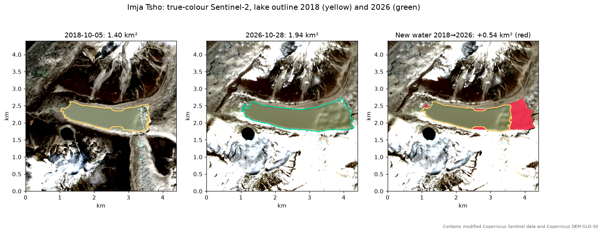
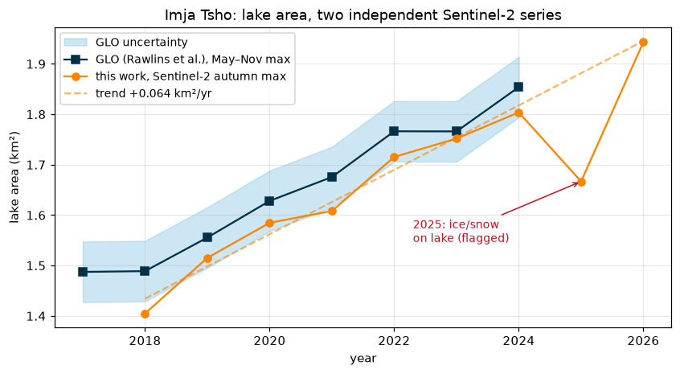
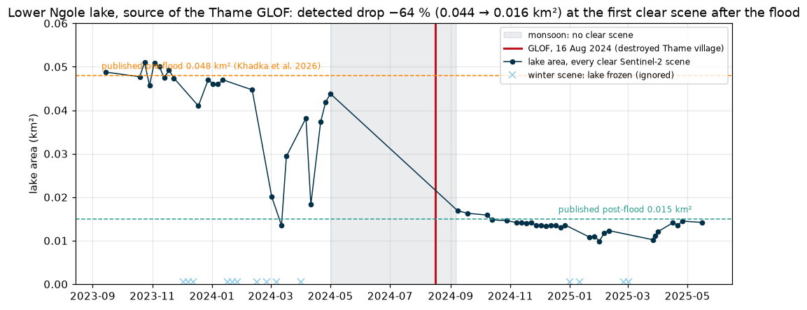
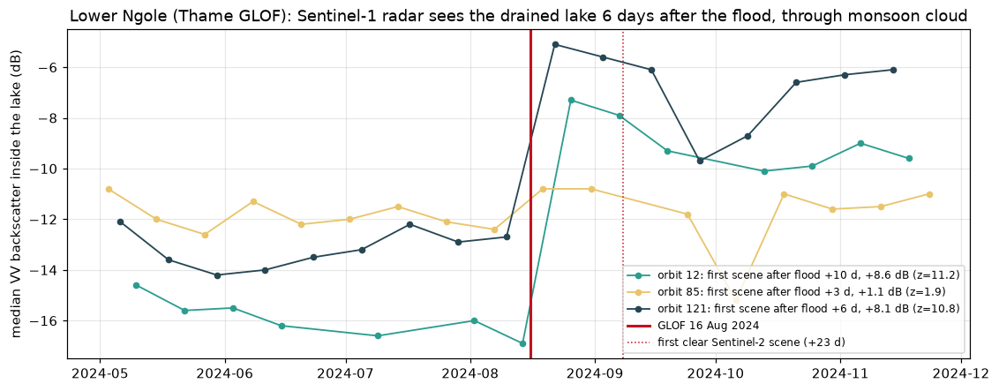
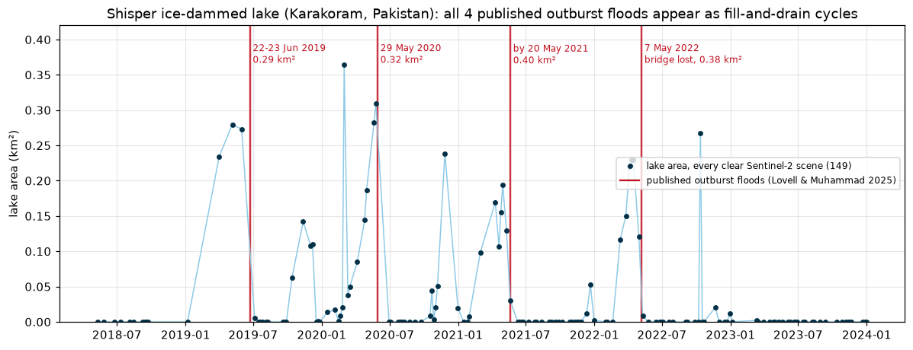

# glof-watch

Open monitoring of glacial lakes for outburst-flood (GLOF) risk, from free Sentinel-2 and Sentinel-1 data.

glof-watch measures lake area in every clear Sentinel-2 scene, extends the published Glacial Lake Observatory (GLO)
series with new years, and runs a weekly check on a watchlist of lakes that flags fast growth or sudden drainage.
Everything runs on open data read over HTTP; no account or large download is needed.



**This is not an early-warning system.** The monitor runs once a week, optical scenes are often hidden by cloud (the
2024 Thame flood was first seen by Sentinel-2 23 days later), and a moraine-dam failure can happen with no visible
change beforehand. Use it to decide where to look, not to warn people.

## Results

| Test | What glof-watch measured | Data |
|---|---|---|
| Imja Tsho, Nepal, 2018-2026 | 1.40 km² (2018) to 1.94 km² (2026), +0.54 km². 1-4 % below GLO in 2019-2024 (autumn scenes only vs GLO's May-November maximum). The 2025 value (1.67 km²) is flagged: lake ice or snow in all 4 scenes. | [csv](docs/data/imja_tsho_autumn_areas.csv) |
| Thame GLOF, 16 Aug 2024 (lower Ngole lake) | Median area 0.038 km² before (Apr-May 2024) and 0.014 km² after (Sep-Dec 2024); published 0.048 to 0.015 km². Sentinel-2 saw it on 8 Sep, 23 days later, because of monsoon cloud. Sentinel-1 radar saw it on 22 Aug, 6 days later (VV backscatter −13.2 to −5.1 dB, z = 10.8). | [scenes](docs/data/thame_lower_ngole_scenes.csv), [radar](docs/data/thame_lower_ngole_sentinel1.csv) |
| Shisper ice-dammed lake, Pakistan, 2018-2023 | All 4 published outburst floods (2019-2022) appear as fill-and-drain cycles in 149 clear scenes. The 2021 and 2022 peaks are under-estimated. | [csv](docs/data/shisper_scenes.csv) |
| Merzbacher ice-dammed lake, Kyrgyzstan, 2025 | Fills in June and drains between the clear scenes of 2 July (2.38 km²) and 22 July (0.20 km²). Sentinel-1 did not help on this ice-choked lake. | [csv](docs/data/merzbacher_2025_scenes.csv) |
| 296 lakes ≥ 0.1 km², Nepal and transboundary basins | Against GLO for 2023-2024 (n = 558 lake-years): median ratio 1.005, median absolute difference 4.3 %, R² 0.958. Fastest growers 2024 to 2026 ranked, with an interactive map. | [csv](docs/data/nepal_lakes_2023_2026.csv), [map](docs/lakes_map.html) |
| 63 lakes draining into Uzbekistan, 2018-2026 | Against the 2022-2024 inventory (n = 54): median absolute difference 5.3 %, R² 0.995. 4 small lakes flagged for fast growth. Of the flagged drops checked in the imagery, none is a confirmed drainage (ice, shadow or unclear). No numbers for the Shakhimardan headwaters: the "lakes" there are mostly snow, ice and shadow at 10 m. | [csv](docs/data/uzbekistan_lakes.csv) |

Details, locations and caveats: [docs/RESULTS.md](docs/RESULTS.md) and [docs/uzbekistan.md](docs/uzbekistan.md).









## How it works

- **Data.** Sentinel-2 L2A and Copernicus DEM GLO-30 from the AWS Earth Search STAC catalogue (anonymous access);
  Cloud Optimized GeoTIFF windows are read over HTTP. Sentinel-1 RTC from Microsoft Planetary Computer.
- **Clear scenes.** A scene is used only if the lake window is free of cloud and shadow in the L2A scene
  classification. Scenes where a large share of the lake is classed as snow or ice (a frozen lake) are skipped.
- **Water.** NDWI (green vs near-infrared) above 0.2. For ice-dammed lakes a colour test separates turbid meltwater
  from dark debris-covered ice. The lake is the water body connected to a seed point, a seed box or the GLO outline.
- **Annual area.** The maximum of up to 4 clear autumn scenes per year, so one under-measured scene does not pull a
  year down.
- **Radar.** Median VV backscatter inside the lake, compared within each relative orbit. Open water is dark; a drained
  bed is bright.

| Script | Does |
|---|---|
| `scripts/lake_timeseries.py` | annual area series for one lake |
| `scripts/lake_scenes.py` | area in every clear scene (fill and drain) |
| `scripts/lakes_batch.py` | many lakes at once, using GLO outlines as reference |
| `scripts/analyse_and_map.py` | calibration against GLO, growth ranking, interactive map |
| `scripts/s1_lake.py` | Sentinel-1 radar check |
| `scripts/lake_visuals.py`, `scripts/lake_video.py` | true-colour figures, 3D view, fly-around video |
| `scripts/monitor.py` | weekly watchlist check |
| `scripts/uz_*.py` | Uzbekistan lake selection, settlements, report |

## Quick start

```bash
git clone https://github.com/bristleconelab/glof-watch && cd glof-watch
uv venv --python 3.12 .venv && uv pip install --python .venv/bin/python -r requirements.txt

# Imja Tsho annual area, 2017-2026
.venv/bin/python scripts/lake_timeseries.py --name "Imja Tsho" --lat 27.8986 --lon 86.9239 \
    --years 2017-2026 --months 10,9,11 --max-cloud 40 --tries 8 --per-year 4 --out out/imja

# Every clear scene of the Shisper ice-dammed lake
.venv/bin/python scripts/lake_scenes.py --name Shisper --bbox 74.540,36.348,74.590,36.378 \
    --seed 74.556,36.357,74.572,36.364 --start 2018-05-01 --end 2023-12-31 --out out/shisper

# The weekly monitor, run "as of" a date after the Thame flood
.venv/bin/python scripts/monitor.py --watchlist watchlist.json --out out/status --as-of 2024-09-20 --only lower_ngole

# Privacy guard (also runs in CI)
.venv/bin/python tests/test_privacy.py
```

`lakes_batch.py`, `analyse_and_map.py` and `s1_lake.py --glo` need the GLO GeoPackage from its Zenodo record (see
below), saved under `data/glo/`. Each script prints its options with `--help`.

## Weekly monitor

[`.github/workflows/monitor.yml`](.github/workflows/monitor.yml) runs `scripts/monitor.py` every Monday at 03:00 UTC on
the lakes in [`watchlist.json`](watchlist.json) and commits [`status/STATUS.md`](status/STATUS.md) and
`status/latest.json`. It uses the clear scenes of the last 120 days and needs an earlier median of at least 0.02 km²:

- **DRAINAGE**: both of the last 2 clear scenes are below 50 % of the median of the earlier scenes.
- **POSSIBLE DRAINAGE**: only the latest scene is below 40 %; wait for the next clear scene.
- **GROWTH**: both of the last 2 clear scenes are above 125 %.
- **NO DATA**: fewer than 4 clear scenes (cloud, frozen lake).

Back-tested on three real outbursts (Shisper 2022, Thame 2024, Merzbacher 2025): each was flagged as DRAINAGE or
POSSIBLE DRAINAGE after it happened, and the run as of 6 days before the Thame flood said OK. Shisper showed GROWTH 12 days before its 2022 outburst; that is
one case, not a forecast skill. Results and rules: [docs/MONITORING.md](docs/MONITORING.md),
back-test files in [`status/`](status/).

## Limitations

- Optical data fail under cloud, lake ice, snow and terrain shadow. Single-scene dips and spikes are common, so every
  flag needs a look at the imagery.
- 10 m pixels cannot reliably measure very small lakes: the Shakhimardan candidates (0.005-0.034 km²) could not be measured.
- Lake area is not lake volume: a lake can lose water by a level drop that area does not show (the upper Ngole lake in
  2024).
- Radar is not yet part of the weekly monitor, and it did not work on an ice-choked lake (Merzbacher).
- Only four lakes are on the watchlist. Downstream exposure in the Uzbekistan report is a straight-line distance to
  the nearest settlement, not a flood model.

## Data and licences

| Data | Use | Licence |
|---|---|---|
| Copernicus Sentinel-2 L2A and Sentinel-1 | lake area, radar check | Copernicus Sentinel data terms (free, full and open; attribute "Contains modified Copernicus Sentinel data [year]") |
| Sentinel-1 RTC, Microsoft Planetary Computer | radar check | per the Planetary Computer dataset page |
| Copernicus DEM GLO-30 | 3D view, slope filter | Copernicus DEM licence (free use with attribution) |
| Glacial Lake Observatory (Rawlins et al., ESSD 2026), doi:10.5281/zenodo.17802334 | reference outlines and areas, Nepal and transboundary basins | CC BY 4.0 |
| High Mountain Asia glacial lake inventory (Kumar & Vijay 2025), doi:10.5281/zenodo.17948783 | Uzbekistan lake selection | CC BY 4.0 |
| HydroBASINS (HydroSHEDS) | Uzbekistan drainage paths | HydroSHEDS licence terms |
| Natural Earth | borders | public domain |
| OpenStreetMap | rivers, settlements, map tiles | ODbL, © OpenStreetMap contributors |

Lake areas and outbreak dates from the literature (Khadka et al. 2026, Lovell & Muhammad 2025) are cited in
[docs/RESULTS.md](docs/RESULTS.md). Code: MIT, see [LICENSE](LICENSE). Contains modified Copernicus Sentinel data
(2018-2026) and Copernicus DEM GLO-30.

## Citation

There is no paper or DOI yet. Please cite the repository:

```
Ismoilov, O. (2026). glof-watch: open monitoring of glacial lakes from Sentinel-2 and Sentinel-1.
https://github.com/bristleconelab/glof-watch
```

and the Glacial Lake Observatory when you use its outlines.

---

<p align="center">
  <sub>Powered by</sub><br>
  <a href="https://github.com/bristleconelab">
    <picture>
      <source media="(prefers-color-scheme: dark)" srcset="docs/img/brand/bristleconelab-horizontal-on-dark.svg">
      
    </picture>
  </a>
</p>
