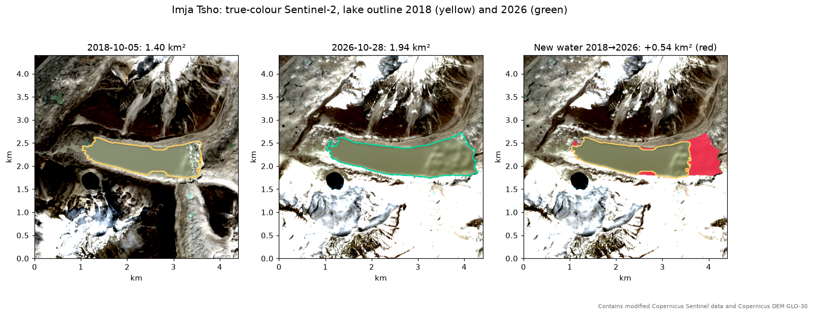
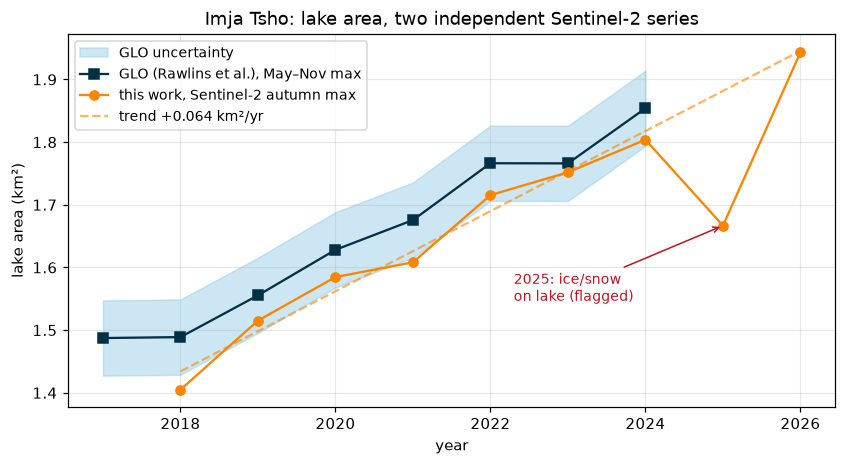
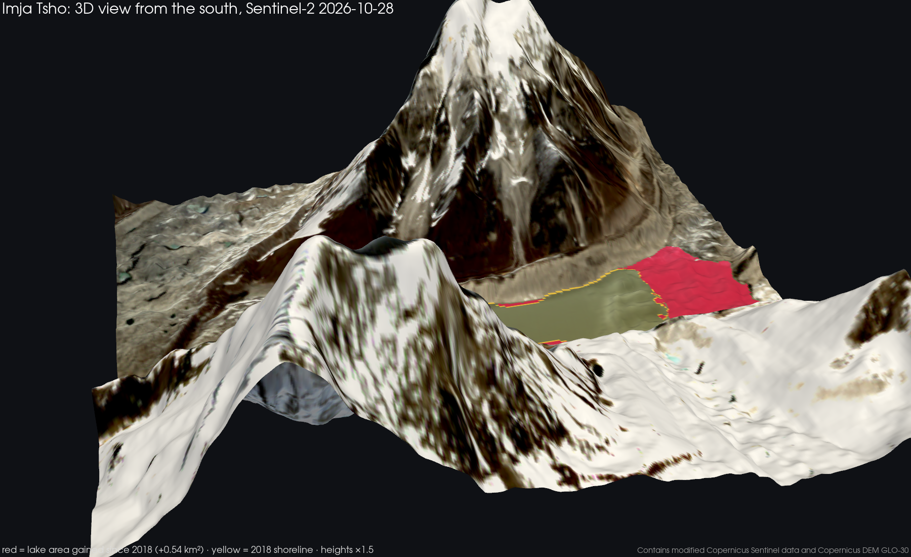
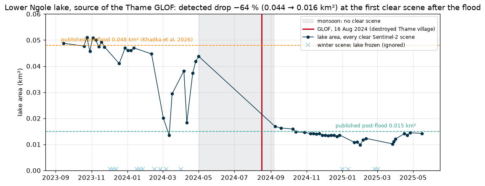
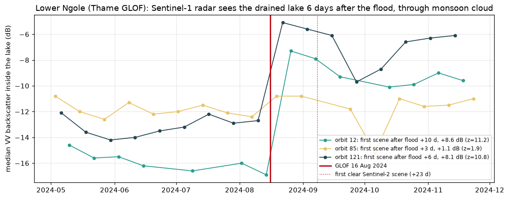
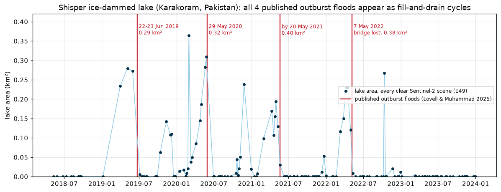
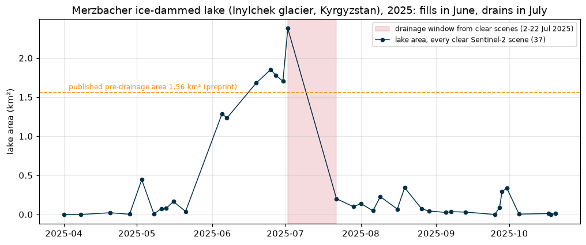
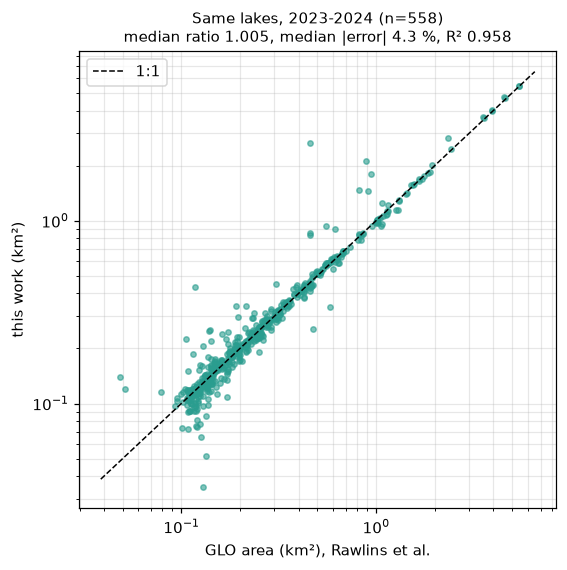
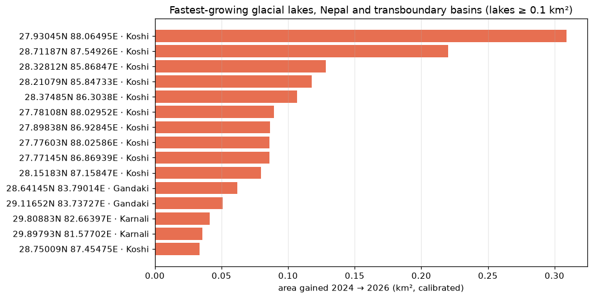

# Results (2026-11-12)

What glof-watch has measured so far: numbers, locations, figures and data. Everything here comes from free satellite
data (Sentinel-2 L2A, Copernicus DEM GLO-30) plus the open Glacial Lake Observatory (GLO) inventory as a reference.

| Result | Status |
|---|---|
| Imja Tsho 2018-2026 area series, checked against two published series | ✅ done |
| Thame GLOF (16 Aug 2024): drop detected in Sentinel-2 (+23 days, cloud) and Sentinel-1 radar (+6 days) | ✅ done |
| 3D view of Imja Tsho (Copernicus DEM + Sentinel-2) | ✅ done |
| 296 lakes ≥ 0.1 km² in Nepal and transboundary basins, 2023-2026: calibration, ranking, interactive map | ✅ done (v2) |
| Shisper ice-dammed lake (Karakoram): all 4 published outburst floods detected, 2018-2023 | ✅ done |
| Merzbacher ice-dammed lake (Kyrgyzstan): 2025 fill and drainage detected | ✅ done |

---

## 1. Imja Tsho, Khumbu, Nepal: a lake that keeps growing

**Location:** 27.8986 N, 86.9239 E · GLO id `GLO_86.92845_27.89838` ·
[Google Maps (satellite)](https://www.google.com/maps/@27.8986,86.9239,2500m/data=!3m1!1e3)

| Year | GLO, May-Nov max (km²) | This work, autumn max (km²) |
|---|---|---|
| 2018 | 1.489 | 1.405 (1 scene only) |
| 2019 | 1.555 | 1.515 |
| 2020 | 1.628 | 1.585 |
| 2021 | 1.676 | 1.608 |
| 2022 | 1.766 | 1.715 |
| 2023 | 1.766 | 1.752 |
| 2024 | 1.854 | 1.804 |
| 2025 | – | 1.667 (flagged: lake ice or snow in all 4 scenes) |
| 2026 | – | **1.943** |

- Our values are 1-4 % below GLO in 2019-2024 (6 % in 2018, a single scene) because we use autumn scenes only, while
  GLO takes the May-November maximum. The differences are within GLO's stated ±0.06 km² uncertainty, except 2018 and
  2021 (0.08 and 0.07 km²).
- An independent Landsat study gives 1.56 km² for 2020 (*Acta Geophysica* 2023); we measure 1.585 km².
- The lake grew about **+0.54 km² from 2018 to 2026**, mainly at its eastern end where the Imja and Lhotse Shar glaciers
  calve into it. Icebergs are visible there in the 2018 image.

3D view: Copernicus DEM GLO-30 draped with Sentinel-2 true colour (28 Oct 2026), heights ×1.5. Yellow is the 2018
shoreline and red the water gained since 2018. Made with `scripts/lake_visuals.py`; `scripts/lake_video.py` renders
the same scene as a fly-around video.

Data: [data/imja_tsho_autumn_areas.csv](data/imja_tsho_autumn_areas.csv)

---

## 2. Thame GLOF, 16 August 2024: the drop is visible from space

On 16 August 2024 a glacial lake outburst flood destroyed much of Thame village in the Khumbu. According to Khadka et
al. (NHESS 2026), two Ngole lakes were involved. The upper lake released water into the lower one, and the lower lake's
moraine dam failed.

| Lake | Location | GLO id | Published |
|---|---|---|---|
| **Lower Ngole (breached)** | 27.82796 N, 86.57281 E · [map](https://www.google.com/maps/@27.82796,86.57281,1500m/data=!3m1!1e3) | `GLO_86.57281_27.82796` | 0.048 → 0.015 km² |
| Upper Ngole | 27.83346 N, 86.56368 E · [map](https://www.google.com/maps/@27.83346,86.56368,1500m/data=!3m1!1e3) | `GLO_86.56368_27.83346` | 0.11 km², about 4×10⁵ m³ released |

The papers do not publish coordinates. These are GLO polygon centroids matched to the published areas and elevations
(inference).

- Every clear Sentinel-2 scene, Sep 2023 to May 2025: median **0.038 km² before** (Apr-May 2024) and **0.014 km² after**
  (Sep-Dec 2024), a drop of about **63 %**. Published values are 0.048 → 0.015 km².
- First clear scene after the flood: **8 Sep 2024, 23 days later**. Monsoon cloud hid the lake from May to September.
  Sentinel-1 radar would close that gap.
- **Sentinel-1 radar closes the cloud gap.** Inside the pre-flood outline, the median VV backscatter (Planetary
  Computer `sentinel-1-rtc`, compared within each relative orbit) jumps in orbit 121 from −13.2 ± 0.7 dB (May to
  mid-August) to **−5.1 dB on 22 Aug 2024, 6 days after the flood (z = 10.8)**. Orbit 12 shows the same change 10 days
  after the flood (−15.9 to −7.3 dB, z = 11.2), and both stay bright afterwards. Open water is dark to radar, while the
  drained bed of wet sediment and boulders is bright. Orbit 85, 3 days after the flood, changed only weakly (z = 1.9);
  we have not checked why.

- Winter and spring scenes show the lake frozen (area ≈ 0) and are excluded. Spring 2024 also has partial-ice dips.
  An alert therefore needs a sustained drop, not one scene.
- The upper lake kept roughly its area (0.097 km² in September 2024). Its release shows up as a level drop, which
  optical area cannot see.

Data: [data/thame_lower_ngole_scenes.csv](data/thame_lower_ngole_scenes.csv) ·
[data/thame_lower_ngole_autumn.csv](data/thame_lower_ngole_autumn.csv) ·
[data/thame_upper_ngole_autumn.csv](data/thame_upper_ngole_autumn.csv) ·
[data/thame_lower_ngole_sentinel1.csv](data/thame_lower_ngole_sentinel1.csv)

---

## 3. Shisper ice-dammed lake, Karakoram, Pakistan: four outburst floods in four years

**Location (lake basin):** about 36.3605 N, 74.5640 E, where the surging Shisper Glacier blocks the river from Muchuhar
Glacier · [Google Maps (satellite)](https://www.google.com/maps/@36.3605,74.564,3000m/data=!3m1!1e3)

| Published flood (Lovell & Muhammad 2025) | Published lake area | Our last scene before | Our first scene after | Detected |
|---|---|---|---|---|
| 22-23 Jun 2019 | 0.29 km² | 31 May: **0.27** | 5 Jul: 0.01 | ✅ |
| 29 May 2020 | 0.32 km² | 25 May: **0.31** | 29 Jun: 0.00 | ✅ |
| drained by 20 May 2021 | 0.40 km² | 10 May: 0.13 | 20 May: 0.03 | ✅ (peak under-estimated) |
| 7 May 2022, Hassanabad bridge lost | 0.38 km² | 30 Apr: 0.12 | 10 May: 0.01 | ✅ (peak under-estimated) |

- 149 clear Sentinel-2 scenes from May 2018 to Dec 2023. All four published outbursts appear as a fill-then-empty
  cycle, each bracketed by clear scenes. In 2019 and 2020 the pre-flood area matches the published area within 0.02 km².
- 2021 and 2022 peaks are under-estimated (0.19-0.23 vs 0.38-0.40 km²). Spring lake ice is the likely cause; we have
  not checked this.
- **Water rule:** NDWI alone also flags dark debris-covered ice on the glacier tongue. We add a colour test
  (turbid meltwater is greener than red, debris is grey) and a morphological opening, and keep only water connected to
  a seed box in the lake basin.
- **Other drops:** four further drops of more than 50 % between consecutive scenes appear. One (Dec 2019) may be real:
  local news reported the lake draining in January 2020. Two are in winter (likely ice). One, a single-scene spike in
  Oct 2022, is unexplained. An alert should need a sustained change over several scenes, not a single scene.
- No lake formed after mid-2022, consistent with the published record ("no lake formed in 2022-23 or 2023-24").

Data: [data/shisper_scenes.csv](data/shisper_scenes.csv)

---

## 4. Merzbacher ice-dammed lake, Inylchek glacier, Kyrgyzstan (2025)

**Location (from the Sentinel-2 image):** about 42.21 N, 79.85 E ·
[Google Maps (satellite)](https://www.google.com/maps/@42.21,79.85,6000m/data=!3m1!1e3). This is the first test in
Central Asia.

- 37 clear Sentinel-2 scenes, Apr-Oct 2025. The lake fills through June (1.29 → 1.85 km²) and drains between the clear
  scenes of **2 July (2.38 km²) and 22 July (0.20 km²)**.
- A 2025 preprint reports 1.56 → 0.008 km² and a 12.55 m water-level drop from SWOT. Our peak is 10-20 % larger,
  probably because floating ice inside the lake is counted with the water once holes are filled (not checked).
- **Sentinel-1 did not help here.** Only one relative orbit covers the lake (12-day revisit), and the median VV inside
  the lake box hardly changed (−7.3 to −7.5 dB). The lake is full of floating ice, which is bright to radar whether the
  lake is full or empty, and the box also contains glacier. Radar can fail on ice-choked lakes.

Data: [data/merzbacher_2025_scenes.csv](data/merzbacher_2025_scenes.csv) ·
[data/merzbacher_2025_sentinel1.csv](data/merzbacher_2025_sentinel1.csv)

---

## 5. Nepal and transboundary basins: 296 lakes, 2023-2026

GLO lakes ≥ 0.1 km² in 2024 were extended with our own Sentinel-2 areas for 2023-2026. The lake is the water touching
GLO's 2024 outline, and each year's value is the maximum of up to 4 clear autumn scenes.

**Calibration against GLO (same lakes, 2023-2024, n = 558 lake-years): median ratio 1.005, median absolute
difference 4.3 %, R² 0.958.**

**Fastest-growing lakes 2024 → 2026.** The ranking is conservative: 2026 is compared with the larger of our 2024 value
and GLO's 2024 value, so one under-measured scene cannot create growth.

| Lake (GLO id) | Location | Basin | 2024 (km²) | 2026 (km²) | Gained | Map |
|---|---|---|---|---|---|---|
| GLO_88.06495_27.93045 | 27.9305 N, 88.0650 E | Koshi (China) | 1.25 | 1.56 | +0.31 km² (+25 %) | [map](https://www.google.com/maps/@27.93045,88.06495,3000m/data=!3m1!1e3) |
| GLO_87.54926_28.71187 | 28.7119 N, 87.5493 E | Koshi (China) | 0.43 | 0.65 | +0.22 km² (+51 %) | [map](https://www.google.com/maps/@28.71187,87.54926,3000m/data=!3m1!1e3) |
| GLO_85.86847_28.32812 | 28.3281 N, 85.8685 E | Koshi (China) | 1.89 | 2.03 | +0.13 km² | [map](https://www.google.com/maps/@28.32812,85.86847,3000m/data=!3m1!1e3) |
| GLO_85.84733_28.21079 | 28.2108 N, 85.8473 E | Koshi (China) | 0.51 | 0.63 | +0.12 km² (+23 %) | [map](https://www.google.com/maps/@28.21079,85.84733,3000m/data=!3m1!1e3) |
| GLO_88.02952_27.78108 | 27.7811 N, 88.0295 E | Koshi (Nepal) | 0.19 | 0.28 | +0.09 km² (+48 %) | [map](https://www.google.com/maps/@27.78108,88.02952,3000m/data=!3m1!1e3) |
| GLO_86.92845_27.89838 (Imja Tsho) | 27.8984 N, 86.9285 E | Koshi (Nepal) | 1.85 | 1.95 | +0.09 km² | [map](https://www.google.com/maps/@27.89838,86.92845,3000m/data=!3m1!1e3) |

**Interactive map:** [lakes_map.html](lakes_map.html). Download it and open it in a browser: satellite, topographic and
OSM base layers, lakes coloured by change, and a popup per lake with the 2017-2026 table and a Google Maps link.
All numbers: [data/nepal_lakes_2023_2026.csv](data/nepal_lakes_2023_2026.csv).

**How the first run went wrong, and the fix.** Version 1 flagged 80 "sudden drops". Checking them showed lake ice
(the L2A classification marked 100 % of one lake snow/ice on 4 Oct 2026) and NDWI failing in deep-valley shadow
(the classification said 86 % water). Version 2 skips scenes where more than 20 % of the lake is snow/ice, accepts the
L2A water class as well as NDWI, and prefers September-October scenes. Drop flags fell from 80 to 6. Of those 6:
three use May-June scenes (lakes are seasonally smaller then), one rests on a bad 2024 value, and one
(GLO_87.78209_27.74467, 0.17 → 0.07 km² in Oct 2025) is still being checked scene by scene.

---

## Credits

Contains modified Copernicus Sentinel data (2018-2026) and Copernicus DEM GLO-30. Reference inventory: Glacial Lake
Observatory (Rawlins et al., ESSD 2026, CC BY 4.0, doi:10.5281/zenodo.17802334). Thame lake areas: Khadka et al., NHESS 2026. Shisper floods: Lovell & Muhammad, Journal of Glaciology 2025.
Imja Landsat comparison: *Acta Geophysica* 2023, doi:10.1007/s11600-023-01124-2.
