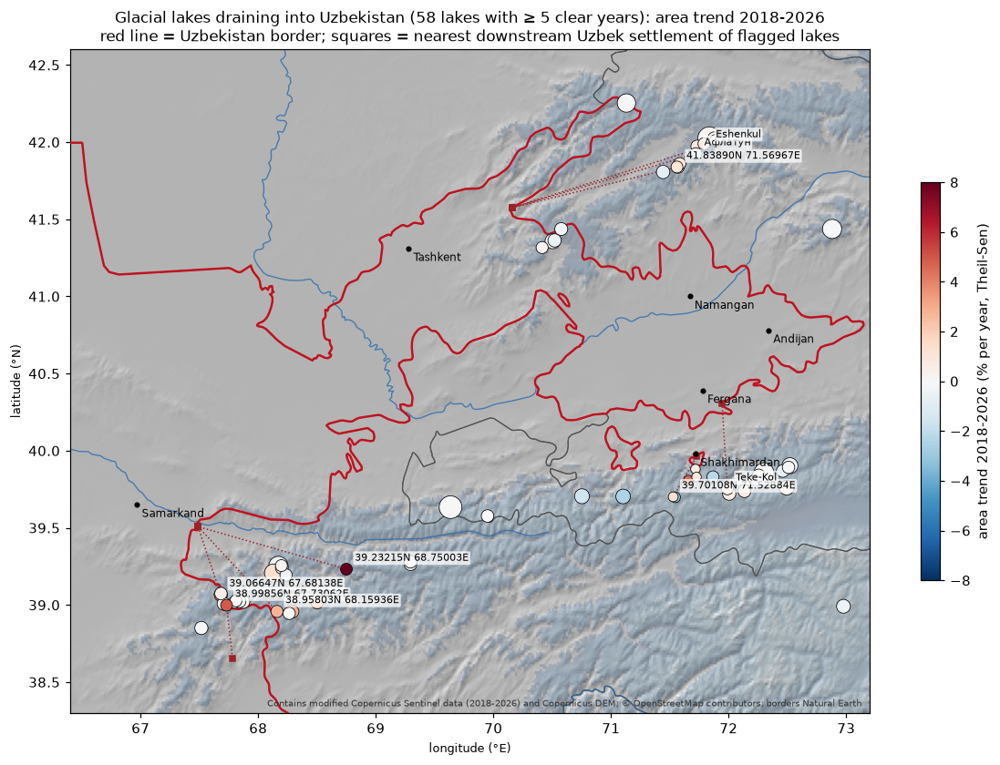
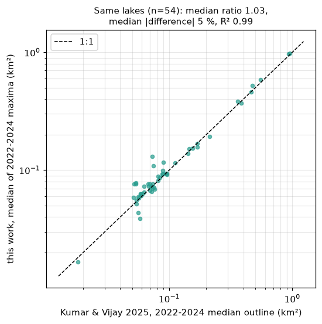
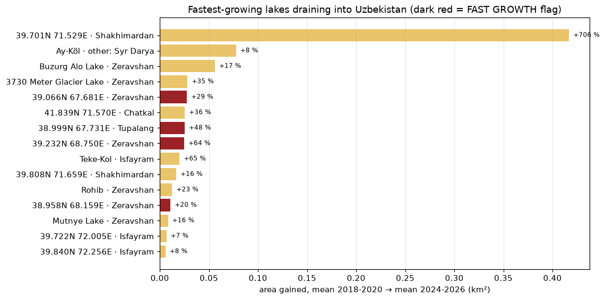
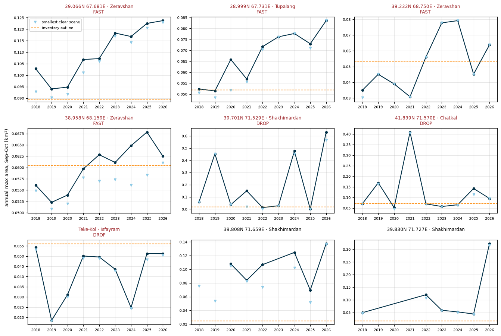
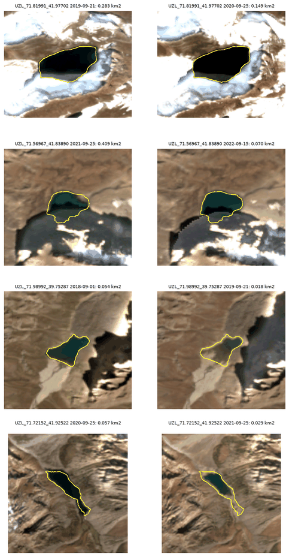
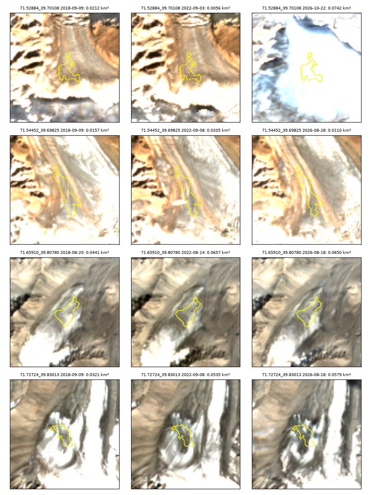

# Glacial lakes that drain into Uzbekistan (2026-11-12)

**Why Uzbekistan.**

- **The deadliest Central Asian GLOF of the last century** hit the Shakhimardan catchment on 8 July 1998. The lake was on the
  Kyrgyz side; more than 100 people died, most of them in the Uzbek enclave of Shakhimardan, and no warning crossed the
  border (Petrakov et al. 2020, *Science of the Total Environment*).
- **Uzbek territory.** Petrov et al. (2017) count 242 glacial lakes there and rate 15 % of them as outburst-prone.
- **Lakes upstream.** Most lakes that threaten Uzbek valleys lie upstream in Kyrgyzstan and Tajikistan.

## Data and method

- **Lakes.** Kumar & Vijay (2025), the High Mountain Asia glacial lake inventory: median outlines for 2022–2024,
  CC BY 4.0, doi:10.5281/zenodo.17948783.
  - Selection: lakes of at least 0.05 km² inside 66.5–73.0 E, 38.0–42.5 N.
  - Drainage: each lake's path is followed downstream through HydroBASINS level 10 (`NEXT_DOWN`) until it enters
    Uzbekistan (Natural Earth border, enclaves included), within 200 river-km.
  - Basin names come from OpenStreetMap rivers (`scripts/uz_select.py`).
- **Shakhimardan headwaters.** Lakes in this catchment were added from a dedicated mapping run (`scripts/uz_catchment_lakes.py`).
- **Annual area 2018–2026.** The same Sentinel-2 L2A method as the rest of glof-watch (`scripts/lakes_batch.py`):
  NDWI > 0.2, the SCL cloud mask, and the maximum of the clear September–October scenes.
- **Trend and flags** (`scripts/uz_report.py`):
  - **Trend:** Theil–Sen.
  - **FAST GROWTH:** the 2024–26 median is more than 20 % and more than 0.01 km² above the 2018–20 median, and the trend's
    lower 90 % bound is above zero.
  - **DROP:** a year falls below 60 % of the previous median.
  - **Exposure:** the nearest Uzbek settlement (OpenStreetMap) in the lake's downstream sub-basins.

## Validation

| check | result |
|---|---|
| Our 2022–24 areas vs the inventory's 2022–24 median outlines | n = 54, median ratio 1.035, **median absolute error 5.3 %, R² 0.995** |
| Visual check of the 4 fastest growers (Sentinel-2 true colour, first vs last year) | 3 clearly larger, 1 modest; one has a 2018 image partly in shadow |
| Visual check of 4 "drops" | **2 are false**: one is ice or snow along the shore with an identical outline, one is terrain shadow. 2 are unclear |

## Results

**63 lakes selected, 58 with at least 5 clear years. 4 flagged FAST GROWTH, 5 flagged DROP.**

### Fast growth (all in the Zeravshan / Tupalang headwaters, Tajikistan side)

| lake (lon, lat) | basin | area 2018–20 → 2024–26 (km²) | change | confidence | nearest downstream Uzbek settlement |
|---|---|---|---|---|---|
| 67.681 E, 39.066 N | Zeravshan | 0.095 → 0.123 | +29 % | **high**: steady rise every year, visible in imagery | Tegirmonteppa, 52 km |
| 67.731 E, 38.999 N | Tupalang | 0.052 → 0.078 | +48 % | **high**: visible in imagery; some years' scenes disagree | Vochax, 39 km |
| 68.159 E, 38.958 N | Zeravshan | 0.054 → 0.065 | +20 % | medium: steady but small | Tegirmonteppa, 84 km |
| 68.750 E, 39.232 N | Zeravshan | 0.039 → 0.064 | +64 % | **low**: scenes disagree in every year and the 2018 image is shadowed | Tegirmonteppa, 113 km |

All four are small: today's areas are 0.06–0.12 km². They are worth watching, but none is close to the size of the
lakes behind the big Himalayan GLOFs.

### Drops (possible drainage), mostly artefacts

| lake | basin | flagged drop | verdict |
|---|---|---|---|
| 71.820 E, 41.977 N | Chatkal | 2020 and 2022: 0.15 vs 0.28–0.30 km² | **false**: same outline in both images; the area swings with shore ice and snow |
| 71.570 E, 41.839 N | Chatkal | 2022: 0.07 vs 0.17 | **false**: the lake is in terrain shadow in the 2022 scene |
| 71.990 E, 39.753 N | Isfayram | 2019: 0.018 vs 0.054 | unclear: looks partly drained or turbid in 2019, back to normal in 2021 |
| 71.722 E, 41.925 N | Chatkal | 2021: 0.029 vs 0.055 | unclear |
| 71.529 E, 39.701 N | **Shakhimardan** | many years | **series broken**: see below |

### Shakhimardan: Sentinel-2 at 10 m cannot measure these lakes (checked 2026-11-13)

The headwaters above the 1998 disaster site hold **19 candidate lakes**: 9 from the inventory and 10 more from our 2025
lake map. All are tiny (0.005–0.034 km², 50–340 pixels) and lie at 3,900–4,600 m.

**What we tried:**

1. **First run.** Yearly values jumped between 0.01 and 0.63 km², because water connected to the lake leaked into rivers,
   wet valley floors and shadow.
2. **Second run.** `lakes_batch.py --clip-px 6`, which counts water only within 60 m of each outline, removed the leaks.
   But several lakes then repeat the **same maximum** (for example 0.0742 km²) in many years. That number is the area of the
   60 m zone itself: the whole zone was flagged as "water".
3. **Visual check.** Sentinel-2 true colour for the four largest candidates in 2018, 2022 and 2026:

| candidate | what the imagery shows |
|---|---|
| 71.529 E, 39.701 N | the outline sits on a glacier tongue and debris; in 2026 the scene is **under fresh snow**, yet 0.074 km² was counted as water |
| 71.545 E, 39.698 N | a long, thin outline along the glacier: a channel or shadow, **no open water** |
| 71.659 E, 39.808 N | a bright ice or firn patch, **no dark water** |
| 71.727 E, 39.830 N | a few small dark spots on the glacier; **possible small supraglacial ponds** |

**Conclusion.** Most Shakhimardan "lakes" in the inventory and in our own map are **snow, ice and shadow misclassified as
water**. Real lakes, where they exist, are too small for 10 m Sentinel-2 and an automated NDWI threshold. **No area or trend
is reported for Shakhimardan.**

**Two things matter more than the numbers:**

- **Season.** The 1998 outburst came on **8 July**. Periglacial lakes here fill during peak melt in June–July and may drain
  or freeze by September. The glof-watch standard window (September–October) would miss them.
- **What would work instead:**
  - June–July scenes;
  - 3 m PlanetScope or high-resolution basemaps, with lakes mapped by eye;
  - Sentinel-1 radar through cloud;
  - field reports from the Shakhimardan side.

  Petrakov et al. (2020) counted 32 lakes in this catchment in 2018 using finer imagery and fieldwork.

## Limits

- **Only lakes of at least 0.05 km² in one inventory.** Small fast-forming lakes, such as the one that caused the 1998 flood,
  can be missed.
- **Optical data only.** Ice, snow and terrain shadow cause false drops, so every flag needs a visual check.
  Sentinel-1 radar has not been run for these lakes.
- **Exposure is approximate.** The settlement is the nearest point in the downstream sub-basins, measured in a straight
  line. This is not a flood model.
- **Not an early warning.** It is a screening of where to look first.

## Files

- **Data:** `docs/data/uzbekistan_lakes.csv` (per-lake series, trend, flags, settlement) and
  `docs/data/uzbekistan_scene_counts.csv`.
- **Scripts:** `uz_select.py` (selection), `uz_catchment_lakes.py` (Shakhimardan mapping), `uz_osm.py`
  (settlements and rivers), `uz_report.py` (trends, flags, figures).
